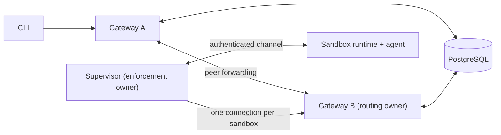
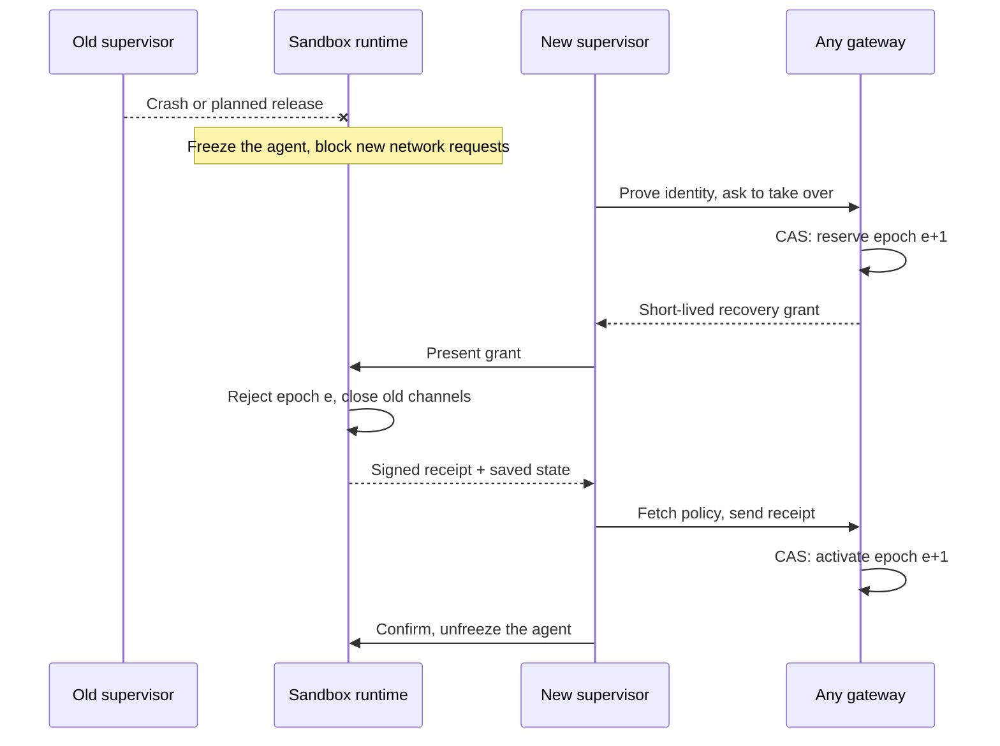

---
authors:
  - "@FrostGod"
state: draft
links:
  - https://github.com/NVIDIA/OpenShell/issues/4311
  - https://github.com/NVIDIA/OpenShell/issues/2385
  - https://github.com/NVIDIA/OpenShell/pull/3661
---

# RFC 0018 - Multi-sandbox and HA Supervisors

## Summary

This RFC proposes four ways to deploy supervisors so that one supervisor can watch several sandboxes and a failed supervisor can be replaced: per workspace, per node, per sandbox, and per gateway. It does not pick one yet. One goal of this RFC is to compare the four models and decide which to implement.

All four models share the same safety rules, listed here:

- One supervisor process can look after one sandbox or several.
- Each sandbox keeps its own policy, credentials, runtime connection, gateway session, and resource limits. Sharing a supervisor does not merge sandboxes or their permissions.
- Each sandbox has only one active supervisor at a time. Before a replacement takes over, the old supervisor must lose its power to act. This is called fencing.
- A replacement can keep the agent process running only if the sandbox runtime can safely recover. Otherwise, recovery starts a fresh sandbox run.
- If only a gateway fails, the supervisor reconnects to another gateway. This does not require replacing the supervisor or restarting the agent.

## Motivation

Today, Kubernetes runs the workload and the supervisor in separate Pods. Gateway HA handles a gateway failing. It does not replace a failed supervisor while keeping its workload running. Sharing supervisors would save Pods, but one failure would then affect more sandboxes.

Operators need to know three things: what fails together, what recovers without restarting the agent, and what isolation is left. The design must cover upgrades, crashes, network partitions, overload, and node loss. It must not promise connections that never drop, and it must not weaken enforcement.

### What the supervisor does

These duties apply to every deployment model, separately for each sandbox:

- **Prove who it is:** log in to the gateway and the sandbox runtime with credentials tied to that sandbox and run. Renew tokens and keep TLS connections trusted.
- **Keep the gateway link alive:** open the sandbox's control session, send heartbeats, receive connection requests, and reconnect when a gateway goes away or sends it elsewhere.
- **Load policy and configuration:** fetch, check, and apply approved policy, provider, and middleware updates, and report what is actually installed. It does not approve its own policy changes.
- **Start the agent safely:** attach to the chosen isolation backend, confirm the boundary and networking are ready, then ask the runtime to start the agent.
- **Decide which network requests are allowed:** check destinations against policy. Where configured, also check HTTP, API, and MCP operations, using the identity of the calling program that the runtime provides.
- **Provide the network path:** resolve DNS, open allowed connections upstream, proxy traffic, and run configured inspection and middleware. The agent does not get unrestricted direct network access.
- **Protect provider credentials:** fetch and refresh credentials and add them only to authorized requests. Prepare provider environment values for future commands only when explicitly configured.
- **Provide interactive access:** serve SSH, terminals, command execution, and file transfer. Ask the backend to run processes, carry I/O, resize terminals, and send signals inside the sandbox.
- **Forward allowed connections:** handle gateway relay requests and use the backend to reach services inside the sandbox without exposing the workload directly.
- **Report health and process state:** publish policy and provider readiness, endpoint observations, and the main process's exit result, so the gateway can show the real sandbox status.
- **Send audit and operational data:** forward logs and traces, record allow and deny decisions, and send activity summaries and policy-analysis proposals.
- **Manage its own sandbox lifecycle:** on exit or shutdown, close proxy and access tasks and release backend handles, without disturbing other sandboxes. The driver still cleans up infrastructure.

The sandbox runtime, not the supervisor process, owns the actual workload processes, the kernel isolation controls, and the checks of which executable is running. The runtime freezes or stops the workload when required supervision is lost. The gateway owns user authorization, policy approval, and durable control-plane state. Its compute driver creates and deletes runtime resources.

## Goals

- **Decide which deployment models to implement.** Compare the four proposed models (per workspace, per node, per sandbox, per gateway) on failure scope, recovery, isolation, Pod cost, and operating effort, and decide which to implement and which should be the default.
- **Define one set of safety rules** that every model follows, so the choice of model changes cost and failure scope but never weakens isolation.
- **Define how a failed supervisor is replaced**, and when the running agent can be kept.

## Non-goals

- Picking a model before it has been compared and tested. The four models below are proposals.
- Saving or live-moving agent memory from a failed node.
- Moving existing TCP, SSH, forwarding, or upstream HTTP connections to another supervisor.
- Running arbitrary external side effects exactly once.
- Removing the trusted sandbox runtime, the outer network fence, or per-sandbox authorization.

## Proposal

### 1. Four proposed models

Each deployment answers two questions:

- **Where does the supervisor run?** Per workspace, per node, per sandbox, or per gateway.
- **How does a sandbox recover when its supervisor fails?** *Restart* or *resume*, described below.

These are candidates to compare, not a decision. All four follow the same safety rules in sections 2 to 4.

| Model | One supervisor serves | Good | Hard |
| --- | --- | --- | --- |
| Per workspace | A pool for one workspace | Trust and quotas stay inside the workspace. Fewer Pods. | One failure hits the whole pool. Small workspaces pay for spare capacity. |
| Per node | The sandboxes on one node (DaemonSet) | Traffic stays on the node. Pod count follows node count. | One failure hits the node, possibly across workspaces. No ready standby on the same node. |
| Per sandbox (today) | One sandbox, with an optional warm standby | Smallest failure. Simplest isolation. | Most Pods. Slow cold start. |
| Per gateway | A group tied to one gateway replica | Easy to run as a group. | Gateway rollouts and scale-in also move the group. Needs its own identity and spare capacity. |

Supervisor sessions never run inside the gateway process or Pod. They parse traffic the agent controls, and the gateway Pod holds the signing keys.

A **workspace** is an OpenShell grouping. It is not always one Kubernetes namespace, so assign supervisors by immutable IDs, never by names, Pod IPs, or namespace. A **supervisor replica** is one real process or Pod. Inside it, each sandbox gets its own **session** with its own policy, credentials, gateway connection, queues, and cleanup.

**Restart** stops the old run and starts a new one. Files on persistent storage survive. Process memory does not. This is how recovery works today.

**Resume** keeps the agent's processes alive. The runtime freezes them briefly, a new supervisor takes over, and they continue. Open network connections still break. If the node or the runtime itself is lost, only restart is possible.

### 2. Two kinds of owner

Each sandbox has two owners, and they change independently:

- **Routing owner:** the gateway replica that holds the sandbox's connection. The supervisor opens this connection, one per sandbox. CLI requests reach the sandbox through it. It moves when a gateway restarts or rebalances (PR #3661). This already works.
- **Enforcement owner:** the one supervisor allowed to apply the sandbox's policy. It moves only when a supervisor is replaced. This RFC adds it.

A shared supervisor serving sandboxes A and B still keeps two separate gateway connections. A's connection may sit on gateway 1 and B's on gateway 2. The gateway never connects directly to the workload, and the workload never connects to the gateway.

Add a per-sandbox record, `SupervisorAssignment`. It names the current enforcement owner, and stores an **epoch** that goes up by one every time the owner changes, plus a time-limited lease. Gateways update it with compare-and-swap (CAS): the write succeeds only if nobody changed the record first. The gateway's existing owner record also stores this epoch. Anything from an older epoch is rejected: relays, policy acknowledgements, readiness reports, and late cleanup.

Resume keeps the same run, so the old supervisor's token would still pass the gateway's `gateway_token_id` check. When a new owner takes over, the same CAS installs a new `gateway_token_id` and blocks the old token from refreshing.

**Ready** means one thing everywhere: policy loaded, network mediation running, ownership current, a gateway connection exists, and the runtime has confirmed enforcement. As today, a sandbox stays Ready while its gateway connection is handed off gracefully.

Any gateway can pick a replacement. It chooses a healthy, compatible candidate with free capacity, and leaves healthy assignments alone. The gateway hash ring is not used for this. No single coordinator or global lock is needed.

### 3. Safe handover (fencing)

The rule: **before a new supervisor acts, the old one must be unable to act.** This is called fencing.

Today a sandbox can only reconnect to the same supervisor process (RFC 0012), and the Kubernetes driver ties each sandbox to one supervisor Pod. So replacement needs protocol and authorization changes, not just a different Pod template. Backends add an optional, versioned recovery extension. Backends without it keep working with restart only.

How it stays safe:

- **Identity is checked, not assumed.** The driver checks the candidate with TokenReview plus a scope mapping. Labels, namespace, or network reachability prove nothing. The gateway then issues a short-lived `RecoveryGrant` tied to the candidate's key, the sandbox, the run, and the new epoch. Launch credentials can never authorize a takeover. Each candidate gets new TLS keys.
- **A missing heartbeat is not proof.** A new owner is reserved only when the old one released, its lease expired, or the runtime proves it cut the old one off.
- **The runtime enforces it.** The runtime accepts only the newer epoch, closes old channels, and stays frozen until activation. A database row alone cannot stop a live socket.
- **If in doubt, stop.** If the runtime cannot freeze or cannot verify enforcement, it stops the agent.

**Timing.** The runtime waits about 30 seconds for a supervisor to come back. The gateway owner record expires after 45 seconds, which is too slow, so takeover uses the epoch instead of waiting. Everything must fit in the window:

`detect + fence + start candidate + restore state + confirm + margin < 30 s`

If PostgreSQL is unavailable, no new takeovers or lease renewals happen. Running sandboxes continue until their lease ends, then freeze and stop. This trades availability for safety. The database must never reuse an epoch, even after a failover or restore.

### 4. What survives, and what stays isolated

The runtime holds the true state: processes, exec IDs, deadlines, exit results, and enforcement state. A new supervisor rebuilds from that state plus the approved policy from the gateway. It never relearns trust from the running agent. If binary identity pins or policy revisions cannot be restored, resume is refused.

During resume:

- Commands are never run twice. Exec deadlines are never extended.
- Missing output is reported as truncated.
- Proxied connections are closed, and HTTP requests are not replayed.
- Credentials are fetched fresh. Plaintext secrets are never stored in recovery records.

| Today | Change | Still guaranteed |
| --- | --- | --- |
| One supervisor Pod per sandbox | Shared replicas plus per-sandbox assignments | Authorization is exact per sandbox and run. |
| Reconnect only to the same process | Takeover with a fresh grant and fencing | Never two owners. Launch tokens cannot take over. |
| Supervisor state only in memory | State kept by the runtime | No policy rollback. No duplicate exec. |
| Supervisor lifetime tied to one sandbox | Shared groups with per-session cleanup | Deleting one sandbox cannot affect another. |

**Isolation does not get weaker.** No privileged Pods, host namespaces, or extra capabilities. Seccomp stays in the runtime. Anything that needs more privilege gets its own security review.

**The network fence needs work.** Today the Kubernetes fence only admits supervisor Pods from the same namespace, and editing it suspends every sandbox there. Each model must say which network path it needs, for example a separate driver-owned ingress policy. That path is reviewed as a fence change. A shared supervisor also sends all its sandboxes' traffic from one Pod IP, so upstream rules and attribution based on IP can no longer separate sandboxes.

**Inside a shared process,** every sandbox has its own policy, credentials, caches, connection pools, relays, logs, and quotas. Software separation still is not as strong as a separate process.

### 5. Operator settings, capacity, and failures

New settings choose the model, the recovery mode, allowed fallbacks, spare capacity, per-sandbox quotas, and time limits for draining and recovery. A workload's own policy cannot widen these. The gateway records the settings each run started with and shows the effective mode. By default, a failed resume starts a fresh run, the same as restart. Ending the sandbox instead must be an explicit operator choice.

**Pod count.** For `N` sandboxes and `R` shared supervisors, the count is about `N + R`. Today it is `2N`, or `3N` with a warm standby per sandbox. Gateway connections still number `N`.

**Relay limits.** Today each gateway replica allows 256 unclaimed relays, and each sandbox 32. The 32 cap only isolates a stuck supervisor that serves one sandbox. Add a gateway-side cap per supervisor replica.

Plan capacity for sessions, throughput, memory, file descriptors, bandwidth, and the largest group that fails together. Spare capacity must be usable by the affected workspace. If the failure budget cannot be met, reject the sandbox or mark HA as degraded.

| Event | What happens |
| --- | --- |
| Gateway fails or rolls out | The supervisor reconnects to another gateway. No supervisor change, no agent restart. A per-gateway group that gets drained follows the supervisor upgrade row. |
| Supervisor crashes; runtime alive | Freeze, fence, then resume if supported and in time. Otherwise restart or stop, per policy. |
| Network partition | No takeover without fencing. The old owner's lease expires. Direct workload egress is never opened. |
| No suitable candidate | Retry within limits and report degraded. Never widen scope or switch backend. |
| Workload node or runtime lost | Restart if policy allows. Process memory is lost. |
| Workload node drain | Draining evicts the workload Pods too, so this is the node lost case in every model. |
| Supervisor upgrade, scale-in, or drain of a supervisor-only node | Stop new assignments, hand each session over with fencing within the 30-second grace period, then stop. |
| Sandbox stop or delete, or authority revoked | Cancel grants. Cleanup wins over a pending recovery and does not touch other sessions. |

Draining a gateway and draining a supervisor are separate. Remote fallback for per-node supervisors is opt-in. A DaemonSet surge helps planned upgrades but is not a crash standby. Use topology spread, resource reservations, and PDBs; PDBs do not stop crashes or controller rollouts. See the [DaemonSet update](https://kubernetes.io/docs/tasks/manage-daemon/update-daemon-set/) and [disruption](https://kubernetes.io/docs/concepts/workloads/pods/disruptions/) guides.

Report assignment and recovery state, rejected stale owners, recovery time and outcome, spare capacity, and per-replica load. Keep sandbox IDs out of metric labels. Measure how long agents stay frozen separately from client reconnect time, and publish measured recovery times for each backend.

### 6. Who does what, and compatibility

- **Gateway:** assignments, grants, and routing.
- **Compute driver:** creates candidates and does fenced cleanup. Today its reconciler suspends a sandbox when the dedicated supervisor Pod is missing or replaced. It must read `SupervisorAssignment` instead, and its singleton lease must be fenced too.
- **Runtime and backend:** fencing and process state.
- **Supervisor:** separate per-sandbox contexts and approved configuration.
- **Controllers and Helm:** pools, placement, resources, and disruption settings. They cannot authorize a takeover.

Existing installations keep today's behavior (per sandbox, restart only) unless operators opt in. Mixed versions reject resume they do not support. A running sandbox keeps the mode it started with. Docker, Podman, VM, and MXC keep their current behavior until each passes the conformance tests.

## Implementation plan

1. Agree on the recovery and security contract that all four models share, and amend RFC 0012's same-process restriction. Define lease ordering, authenticated fencing receipts, clocks, and versioned wire messages before turning on sharing.
2. Build assignment and grant storage, distributed driver fencing, runtime recovery state, and supervisor replacement. Test the protocol first with dedicated supervisors, so sharing does not hide ownership bugs.
3. Add hosting of many isolated sessions and a prototype of each of the four proposed models, behind explicit admission controls. Publish an honest table of which models and backends are supported. Do not call a model HA until its failure cases pass.
4. Test each topology: crashes, OOMs, SIGTERM, gateway churn, node drain and loss, partitions, stale grants, duplicate claims, failures in the middle of a handoff, stop and delete races, policy and credential changes, incompatible versions, and running out of capacity. Check that there is no split brain, no credential leak, no policy bypass, and no duplicate exec. Run sandbox e2e and conformance tests, and a security review. Node drain and loss need a multi-node test lane, since kind CI is single node.
5. Measure recovery from a single failure and the effect of noisy neighbors for each model. Compare the results against the goals, and **decide which models to implement** and which is the default. Record the decision by updating this RFC.
6. Canary mixed versions. Write deployment and configuration guidance. Then promote the chosen models and any other combinations that passed. To roll back, first stop new admissions. Then stop or restart any generation that has resume enabled if an older binary cannot enforce its contract.

## Risks

- Shared processes widen the damage from a compromise or a crash. Scope separation and quotas reduce accidental interference, but some deployments may still need dedicated supervision.
- Lease expiry means that a PostgreSQL or control-plane outage can affect enforcement availability. Longer leases tolerate outages better but slow down takeover. Shorter leases need more renewals and can expire falsely. Benchmark and check the full timeout budget.
- Recovering security and execution state is much harder than reconnecting a stream. If the state cannot be trusted, resume must be refused, even if restarting is inconvenient.
- Comparing four proposed models makes the matrix of configurations to support and test larger. Release only combinations that have been validated, and show which guarantees are not met. A higher replica count is not proof of HA.

## Alternatives

- **Restart-only recovery:** works for all four deployment models without keeping the agent's process. It is simpler when restarting the workload is acceptable, but it does not recover a running process.
- **Rely on Kubernetes restarts alone:** brings Pods back, but it does not get around authorization that is tied to a process, and it does not recover the state of a running boundary. It cannot give safe resume on its own.
- **Active-active supervision of one sandbox:** creates conflicting owners of policy, processes, and credentials. Active-active pools across different sandboxes are still supported. Two owners of the same boundary at once are not.
- **An external proxy or shared service without the supervisor contract:** can centralize upstream networking, but it cannot replace process operations, executable identity, gateway sessions, and boundary enforcement.

## Related work

- [Issue #4311: Multi-sandbox and HA Supervisors](https://github.com/NVIDIA/OpenShell/issues/4311): the original work item for supervising many sandboxes and for high availability.
- [RFC 0012: Isolation Backend](https://github.com/NVIDIA/OpenShell/blob/e1f3c82caa3ed3b65de22889ae7ef32a774878ef/rfc/0012-isolation-backend/README.md): roles that do not depend on placement, strict isolation for each boundary, and today's same-process recovery limit. This draft extends recovery. It does not change the enforcement rules.
- [Kubernetes driver](https://github.com/NVIDIA/OpenShell/blob/e1f3c82caa3ed3b65de22889ae7ef32a774878ef/crates/openshell-driver-kubernetes/README.md) and [runtime authentication](https://github.com/NVIDIA/OpenShell/blob/e1f3c82caa3ed3b65de22889ae7ef32a774878ef/crates/openshell-sandbox-backend/src/sandbox_auth.rs): today's Pod identity and the limits on replacement processes.
- [Gateway HA documentation](https://github.com/NVIDIA/OpenShell/blob/e1f3c82caa3ed3b65de22889ae7ef32a774878ef/docs/kubernetes/high-availability.mdx) and [PR #3661](https://github.com/NVIDIA/OpenShell/pull/3661): placement of gateways by hashing, and durable routing ownership. Do not confuse these with enforcement ownership.
- [Issue #2385](https://github.com/NVIDIA/OpenShell/issues/2385): an earlier proposal for shared supervision, with Pod-density requirements.

## Open questions

- Which of the four proposed models should we implement, and which should be the default?
- What capacity and recovery targets must each of the four models meet, and in what order should they be delivered?
- What lease, clock-skew, startup, and recovery limits can be reliably reached?
- Which local-node and gateway-group affinity rules may operators relax?
- Which security and execution state must be saved before resume is safe?
- Is the exposure from a compromised shared process acceptable, or do we need separate worker processes?
