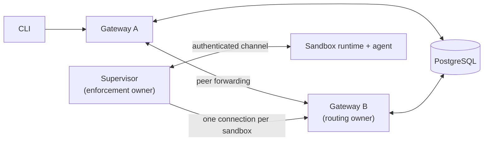
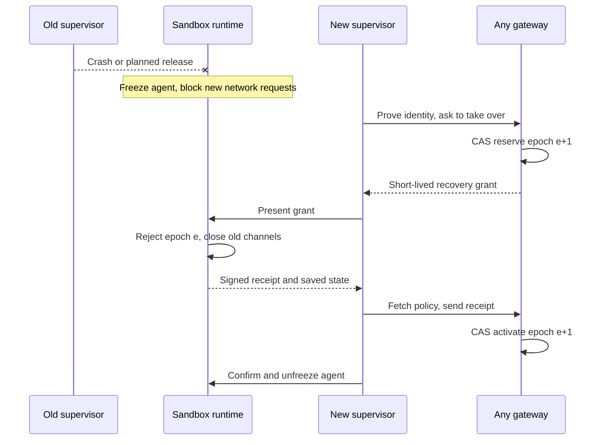
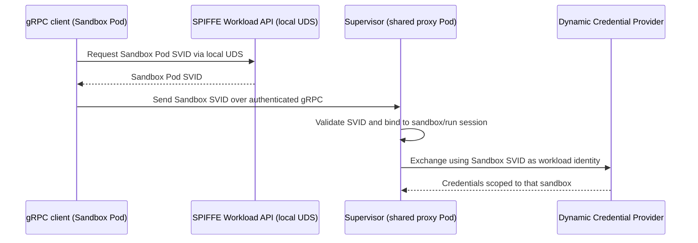

---
authors:
  - "@FrostGod"
state: draft
links:
  - https://github.com/NVIDIA/OpenShell/issues/4311
  - https://github.com/NVIDIA/OpenShell/issues/2385
  - https://github.com/NVIDIA/OpenShell/pull/3661
---

# RFC 0018 - Multi-sandbox and HA Supervisors

## Summary

This RFC proposes four ways to deploy supervisors so that one supervisor can watch several sandboxes and a failed supervisor can be replaced: per workspace, per node, per sandbox, and per gateway. It does not pick one yet. One goal of this RFC is to compare the four models and decide which to implement.

All four models share the same safety rules, listed here:

- One supervisor process can look after one sandbox or several.
- Each sandbox keeps its own policy, credentials, runtime connection, gateway session, and resource limits. Sharing a supervisor does not merge sandboxes or their permissions.
- Each sandbox has only one active supervisor at a time. Before a replacement takes over, the old supervisor must lose its power to act. This is called fencing.
- A replacement can keep the agent process running only if the sandbox runtime can safely recover. Otherwise, recovery starts a fresh sandbox run.
- If only a gateway fails, the supervisor reconnects to another gateway. This does not require replacing the supervisor or restarting the agent.

## Motivation

Today, Kubernetes runs the workload and the supervisor in separate Pods. Gateway HA handles a gateway failing. It does not replace a failed supervisor while keeping its workload running. Sharing supervisors would save Pods, but one failure would then affect more sandboxes.

Operators need to know three things: what fails together, what recovers without restarting the agent, and what isolation is left. The design must cover upgrades, crashes, network partitions, overload, and node loss. It must not promise connections that never drop, and it must not weaken enforcement.

### What the supervisor does

These duties apply to every deployment model, separately for each sandbox:

- **Prove who it is:** log in to the gateway and the sandbox runtime with credentials tied to that sandbox and run. Renew tokens and keep TLS connections trusted.
- **Keep the gateway link alive:** open the sandbox's control session, send heartbeats, receive connection requests, and reconnect when a gateway goes away or sends it elsewhere.
- **Load policy and configuration:** fetch, check, and apply approved policy, provider, and middleware updates, and report what is actually installed. It does not approve its own policy changes.
- **Start the agent safely:** attach to the chosen isolation backend, confirm the boundary and networking are ready, then ask the runtime to start the agent.
- **Decide which network requests are allowed:** check destinations against policy. Where configured, also check HTTP, API, and MCP operations, using the identity of the calling program that the runtime provides.
- **Provide the network path:** resolve DNS, open allowed connections upstream, proxy traffic, and run configured inspection and middleware. The agent does not get unrestricted direct network access.
- **Protect provider credentials:** fetch and refresh credentials and add them only to authorized requests. Prepare provider environment values for future commands only when explicitly configured.
- **Provide interactive access:** serve SSH, terminals, command execution, and file transfer. Ask the backend to run processes, carry I/O, resize terminals, and send signals inside the sandbox.
- **Forward allowed connections:** handle gateway relay requests and use the backend to reach services inside the sandbox without exposing the workload directly.
- **Report health and process state:** publish policy and provider readiness, endpoint observations, and the main process's exit result, so the gateway can show the real sandbox status.
- **Send audit and operational data:** forward logs and traces, record allow and deny decisions, and send activity summaries and policy-analysis proposals.
- **Manage its own sandbox lifecycle:** on exit or shutdown, close proxy and access tasks and release backend handles, without disturbing other sandboxes. The driver still cleans up infrastructure.

The sandbox runtime, not the supervisor process, owns the actual workload processes, the kernel isolation controls, and the checks of which executable is running. The runtime freezes or stops the workload when required supervision is lost. The gateway owns user authorization, policy approval, and durable control-plane state. Its compute driver creates and deletes runtime resources.

## Goals

- **Decide which deployment models to implement.** Compare the four proposed models (per workspace, per node, per sandbox, per gateway) on failure scope, recovery, isolation, Pod cost, and operating effort, and decide which to implement and which should be the default.
- **Define one set of safety rules** that every model follows, so the choice of model changes cost and failure scope but never weakens isolation.
- **Define how a failed supervisor is replaced**, and when the running agent can be kept.

## Non-goals

- Picking a model before it has been compared and tested. The four models below are proposals.
- Saving or live-moving agent memory from a failed node.
- Moving existing TCP, SSH, forwarding, or upstream HTTP connections to another supervisor.
- Running arbitrary external side effects exactly once.
- Backend-initiated suspend and wake ([#4352](https://github.com/NVIDIA/OpenShell/issues/4352)). This is a separate task, but the design leaves room for it: suspend can act as a planned release and wake as a new assignment.
- Removing the trusted sandbox runtime, the outer network fence, or per-sandbox authorization.

## Proposal

### 1. Four proposed models

Each deployment answers two questions: **where the supervisor runs** (per workspace, node, sandbox, or gateway) and **how a sandbox recovers** when its supervisor fails (restart or resume). The models are candidates to compare, not a decision. All four follow the safety rules in sections 2 to 5.

| Model | One supervisor serves | Good | Hard |
| --- | --- | --- | --- |
| Per workspace | A pool for one workspace | Trust and quotas stay inside the workspace. Fewer Pods. | One failure hits the whole pool. Small workspaces pay for spare capacity. |
| Per node | The sandboxes on one node (DaemonSet) | Traffic stays on the node. Pod count follows node count. | One failure hits the node, possibly across workspaces. No ready standby on the node. Fits poorly with backends that move sandboxes between nodes. |
| Per sandbox (today) | One sandbox, with an optional warm standby | Smallest failure. Simplest isolation. | Most Pods. Slow cold start. |
| Per gateway | A group tied to one gateway replica | Easy to run as a group. | Gateway rollouts and scale-in also move the group. Needs its own identity and spare capacity. |

In every model, supervisors run outside the gateway process and Pod: they parse traffic the agent controls, and the gateway Pod holds the signing keys.

Terms used below:

- **Workspace:** an OpenShell grouping, not always one Kubernetes namespace. Assign supervisors by immutable IDs, never by names, Pod IPs, or namespace.
- **Supervisor replica:** one real process or Pod. Inside it, each sandbox gets its own **session** with its own policy, credentials, gateway connection, queues, and cleanup.
- **Restart:** stop the old run and start a new one. Persistent files survive; process memory does not. This is how recovery works today.
- **Resume:** keep the agent's processes, freeze them briefly while a new supervisor takes over, then continue. Open network connections still break. If the node or runtime is lost, only restart is possible.

### 2. Two kinds of owner

Each sandbox has two owners that change independently:

- **Routing owner:** the gateway replica holding the sandbox's connection, which the supervisor opens. CLI requests reach the sandbox through it. It moves when gateways restart or rebalance (PR #3661). This already works.
- **Enforcement owner:** the one supervisor allowed to apply the sandbox's policy. It moves only when a supervisor is replaced. This RFC adds it.

A shared supervisor keeps a separate gateway connection for each sandbox, so sandbox A's connection may sit on gateway 1 and B's on gateway 2. The gateway never connects to the workload, and the workload never connects to the gateway.

A new per-sandbox record, `SupervisorAssignment`, names the enforcement owner. It has a lease and an **epoch**, a counter that goes up by one at every owner change. Gateways update it with compare-and-swap (CAS), a write that fails if someone changed the record first. The gateway's owner record carries the same epoch, and anything from an older epoch is rejected: relays, policy acknowledgements, readiness reports, and late cleanup. The same CAS also issues a new `gateway_token_id`, so the old supervisor's token stops working even though resume keeps the run.

**Ready** has one meaning: policy loaded, network mediation running, ownership current, gateway connected, and enforcement confirmed by the runtime. As today, a sandbox stays Ready through a graceful gateway handoff.

Any gateway can pick a replacement: a healthy, compatible candidate with free capacity. Healthy assignments stay where they are. This uses neither the gateway hash ring nor a global lock.

### 3. Safe handover (fencing)

The rule: **before a new supervisor acts, the old one must be unable to act.** This is called fencing.

Today a sandbox can only reconnect to the same supervisor process (RFC 0012), and the Kubernetes driver ties each sandbox to one supervisor Pod. Replacement therefore needs protocol and authorization changes, not just a new Pod template. Backends add an optional, versioned recovery extension; backends without it keep restart only.

How it stays safe:

- **Identity is checked.** The driver verifies the candidate with TokenReview and a scope mapping; labels, namespace, and reachability prove nothing. The gateway then issues a short-lived `RecoveryGrant` bound to the candidate's key, sandbox, run, and new epoch. Launch credentials never authorize a takeover, and each candidate gets new TLS keys.
- **A missing heartbeat is not proof.** A new owner is reserved only after the old one released, its lease expired, or the runtime proved it cut the old one off.
- **The runtime enforces it.** It accepts only the newer epoch, closes old channels, and stays frozen until activation. A database row alone cannot stop a live socket.
- **If in doubt, stop.** If the runtime cannot freeze or verify enforcement, it stops the agent.

**Timing.** The runtime waits about 30 seconds for a supervisor. The gateway owner record takes 45 seconds to expire, so takeover moves the epoch instead of waiting:

`detect + fence + start candidate + restore state + confirm + margin < 30 s`

If PostgreSQL is down, no takeovers or lease renewals happen. Running sandboxes continue until their lease ends, then freeze and stop, trading availability for safety. The database must never reuse an epoch, even after failover or restore.

### 4. What survives, and what stays isolated

The runtime holds the true state: processes, exec IDs, deadlines, exit results, and enforcement. A new supervisor rebuilds from it plus approved policy from the gateway, and never relearns trust from the running agent. If binary identity pins or policy revisions cannot be restored, resume is refused. During resume, commands never run twice and deadlines never extend. Missing output is reported as truncated. Proxied connections close without replaying HTTP requests, and credentials are fetched fresh, never stored in plaintext.

| Today | Change | Still guaranteed |
| --- | --- | --- |
| One supervisor Pod per sandbox | Shared replicas plus per-sandbox assignments | Authorization is exact per sandbox and run. |
| Reconnect only to the same process | Takeover with a fresh grant and fencing | Never two owners. Launch tokens cannot take over. |
| Supervisor state only in memory | State kept by the runtime | No policy rollback. No duplicate exec. |
| Supervisor lifetime tied to one sandbox | Shared groups with per-session cleanup | Deleting one sandbox cannot affect another. |

- **Isolation does not get weaker.** No privileged Pods, host namespaces, or extra capabilities. Seccomp stays in the runtime. Anything needing more privilege gets its own security review.
- **The network fence needs work.** The Kubernetes fence admits supervisor Pods only from the same namespace, and editing it suspends every sandbox there. Each model must name the network path it needs, such as a separate driver-owned ingress policy, reviewed as a fence change. A shared supervisor also sends all its sandboxes' traffic from one Pod IP, so IP-based upstream rules and attribution can no longer tell sandboxes apart.
- **A shared process separates by sandbox:** policy, credentials, caches, connection pools, relays, logs, and quotas. Software separation is still weaker than a separate process.

### 5. Workload identity

Sharing a supervisor must preserve each sandbox's workload identity. For Kubernetes deployments using pod-specific SPIFFE Verifiable Identity Documents (SVIDs), the identity issuer must distinguish individual Sandbox Pods, even when they share a service account. The shared proxy Supervisor Pod's service identity does not represent the workloads it supervises.

The gRPC client running in the Sandbox Pod MUST obtain that Pod's SVID through the [SPIFFE Workload API](https://spiffe.io/docs/latest/deploying/svids/) Unix domain socket (UDS) exposed locally in the Sandbox Pod and pass the SVID over the authenticated gRPC connection to the Supervisor running in the shared proxy Supervisor Pod. Access to the UDS must preserve workload attestation so the client receives only identities authorized for its Sandbox Pod.

The Supervisor MUST validate the SVID against the configured trust bundle and expected workload identity, including validity and audience where applicable, and bind it to the authenticated sandbox/run session and current ownership epoch. A caller-supplied sandbox ID alone cannot establish that binding. The validated Sandbox SVID MUST be used as the workload identity for dynamic Credential Provider exchange and other identity-dependent operations performed on behalf of that sandbox. The Supervisor must not substitute its own SVID: doing so would collapse distinct sandbox identities into one shared identity and lose per-sandbox authorization and attribution.

The exchange protocol must specify the SVID form, intended audience, and proof required by each provider. For bearer-token exchange, the client obtains a JWT-SVID for the intended recipient; an X.509-SVID certificate alone is not proof of possession. X.509 private keys MUST remain in the Sandbox Pod and must never be forwarded to the Supervisor.

Identity context and exchanged credential caches remain scoped to the sandbox/run, provider, and audience. The client refreshes the SVID before expiry and forwards updates to the active Supervisor. After fenced handover, the client supplies a current SVID to the replacement Supervisor, which validates and binds it to the new session and epoch before fetching fresh credentials. Missing, expired, or mismatched identity must fail closed for operations requiring it, without falling back to another sandbox's identity or the Supervisor's identity. Workload identity does not replace the recovery grant or fencing rules in section 3.

### 6. Operator settings, capacity, and failures

New settings choose the model, recovery mode, allowed fallbacks, spare capacity, per-sandbox quotas, and drain and recovery time limits. A workload's policy cannot widen them. Each run records the settings it started with, and operators see the effective mode. A failed resume starts a fresh run by default; ending the sandbox instead is an explicit operator choice.

- **Pod count:** about `N + R` for `N` sandboxes and `R` shared supervisors, versus `2N` today or `3N` with warm standbys. Gateway connections stay at `N`. If idle sandboxes release their sessions, size by active sandboxes.
- **Relay limits:** each gateway replica allows 256 unclaimed relays and each sandbox 32. The 32 cap only isolates a stuck supervisor that serves one sandbox, so add a gateway-side cap per supervisor replica.
- **Capacity planning:** cover sessions, throughput, memory, file descriptors, bandwidth, and the largest group that fails together. Spare capacity must be usable by the affected workspace. If the failure budget cannot be met, reject the sandbox or mark HA as degraded.

| Event | What happens |
| --- | --- |
| Gateway fails or rolls out | The supervisor reconnects to another gateway. No supervisor change, no agent restart. A per-gateway group that gets drained follows the supervisor upgrade row. |
| Supervisor crashes; runtime alive | Freeze, fence, then resume if supported and in time. Otherwise restart or stop, per policy. |
| Network partition | No takeover without fencing. The old owner's lease expires. Direct workload egress is never opened. |
| No suitable candidate | Retry within limits and report degraded. Never widen scope or switch backend. |
| Workload node or runtime lost | Restart if policy allows. Process memory is lost. |
| Workload node drain | Draining evicts the workload Pods too, so this is the node lost case in every model. |
| Supervisor upgrade, scale-in, or drain of a supervisor-only node | Stop new assignments, hand each session over with fencing within the 30-second grace period, then stop. |
| Sandbox stop or delete, or authority revoked | Cancel grants. Cleanup wins over a pending recovery and does not touch other sessions. |

Gateway and supervisor drains are separate, and remote fallback for per-node supervisors is opt-in. Use topology spread and resource reservations. A DaemonSet surge helps planned upgrades but is no crash standby, and PDBs stop neither crashes nor controller rollouts ([DaemonSet updates](https://kubernetes.io/docs/tasks/manage-daemon/update-daemon-set/), [disruptions](https://kubernetes.io/docs/concepts/workloads/pods/disruptions/)). Report assignment and recovery state, rejected stale owners, recovery outcomes, spare capacity, and per-replica load, keeping sandbox IDs out of metric labels. Measure agent freeze time separately from client reconnect time, and publish recovery times per backend.

### 7. Who does what, and compatibility

- **Gateway:** assignments, grants, and routing.
- **Compute driver:** creates candidates and does fenced cleanup. Its reconciler, which today suspends a sandbox whose dedicated supervisor Pod is missing or replaced, must read `SupervisorAssignment` instead, under a fenced singleton lease.
- **Runtime and backend:** fencing and process state.
- **Supervisor:** separate per-sandbox contexts and approved configuration.
- **Controllers and Helm:** pools, placement, resources, and disruption settings, with no power to authorize a takeover.

Existing installations keep today's behavior (per sandbox, restart only) unless operators opt in. Mixed versions reject resume they do not support, and a running sandbox keeps the mode it started with. Docker, Podman, VM, and MXC keep current behavior until each passes the conformance tests.

## Implementation plan

1. Agree on the recovery and security contract that all four models share, and amend RFC 0012's same-process restriction. Define lease ordering, authenticated fencing receipts, clocks, and versioned wire messages before turning on sharing.
2. Build assignment and grant storage, distributed driver fencing, runtime recovery state, and supervisor replacement. Test the protocol first with dedicated supervisors, so sharing does not hide ownership bugs.
3. Add hosting of many isolated sessions and a prototype of each of the four proposed models, behind explicit admission controls. Publish an honest table of which models and backends are supported. Do not call a model HA until its failure cases pass.
4. Test each topology: crashes, OOMs, SIGTERM, gateway churn, node drain and loss, partitions, stale grants, duplicate claims, failures in the middle of a handoff, stop and delete races, policy and credential changes, incompatible versions, and running out of capacity. Check that there is no split brain, no credential leak, no policy bypass, and no duplicate exec. Run sandbox e2e and conformance tests, and a security review. Node drain and loss need a multi-node test lane, since kind CI is single node.
5. Measure recovery from a single failure and the effect of noisy neighbors for each model. Compare the results against the goals, and **decide which models to implement** and which is the default. Record the decision by updating this RFC.
6. Canary mixed versions. Write deployment and configuration guidance. Then promote the chosen models and any other combinations that passed. To roll back, first stop new admissions. Then stop or restart any generation that has resume enabled if an older binary cannot enforce its contract.

## Risks

- Shared processes widen the damage from a compromise or a crash. Scope separation and quotas reduce accidental interference, but some deployments may still need dedicated supervision.
- Lease expiry means that a PostgreSQL or control-plane outage can affect enforcement availability. Longer leases tolerate outages better but slow down takeover. Shorter leases need more renewals and can expire falsely. Benchmark and check the full timeout budget.
- Recovering security and execution state is much harder than reconnecting a stream. If the state cannot be trusted, resume must be refused, even if restarting is inconvenient.
- Comparing four proposed models makes the matrix of configurations to support and test larger. Release only combinations that have been validated, and show which guarantees are not met. A higher replica count is not proof of HA.

## Alternatives

- **Restart-only recovery:** works for all four deployment models without keeping the agent's process. It is simpler when restarting the workload is acceptable, but it does not recover a running process.
- **Rely on Kubernetes restarts alone:** brings Pods back, but it does not get around authorization that is tied to a process, and it does not recover the state of a running boundary. It cannot give safe resume on its own.
- **Active-active supervision of one sandbox:** creates conflicting owners of policy, processes, and credentials. Active-active pools across different sandboxes are still supported. Two owners of the same boundary at once are not.
- **An external proxy or shared service without the supervisor contract:** can centralize upstream networking, but it cannot replace process operations, executable identity, gateway sessions, and boundary enforcement.

## Related work

- [Issue #4311: Multi-sandbox and HA Supervisors](https://github.com/NVIDIA/OpenShell/issues/4311): the original work item for supervising many sandboxes and for high availability.
- [RFC 0012: Isolation Backend](https://github.com/NVIDIA/OpenShell/blob/e1f3c82caa3ed3b65de22889ae7ef32a774878ef/rfc/0012-isolation-backend/README.md): roles that do not depend on placement, strict isolation for each boundary, and today's same-process recovery limit. This draft extends recovery. It does not change the enforcement rules.
- [Kubernetes driver](https://github.com/NVIDIA/OpenShell/blob/e1f3c82caa3ed3b65de22889ae7ef32a774878ef/crates/openshell-driver-kubernetes/README.md) and [runtime authentication](https://github.com/NVIDIA/OpenShell/blob/e1f3c82caa3ed3b65de22889ae7ef32a774878ef/crates/openshell-sandbox-backend/src/sandbox_auth.rs): today's Pod identity and the limits on replacement processes.
- [Gateway HA documentation](https://github.com/NVIDIA/OpenShell/blob/e1f3c82caa3ed3b65de22889ae7ef32a774878ef/docs/kubernetes/high-availability.mdx) and [PR #3661](https://github.com/NVIDIA/OpenShell/pull/3661): placement of gateways by hashing, and durable routing ownership. Do not confuse these with enforcement ownership.
- [Issue #2385](https://github.com/NVIDIA/OpenShell/issues/2385): an earlier proposal for shared supervision, with Pod-density requirements.

## Open questions

- Which of the four proposed models should we implement, and which should be the default?
- What capacity and recovery targets must each of the four models meet, and in what order should they be delivered?
- What lease, clock-skew, startup, and recovery limits can be reliably reached?
- Which local-node and gateway-group affinity rules may operators relax?
- Which security and execution state must be saved before resume is safe?
- Is the exposure from a compromised shared process acceptable, or do we need separate worker processes?
